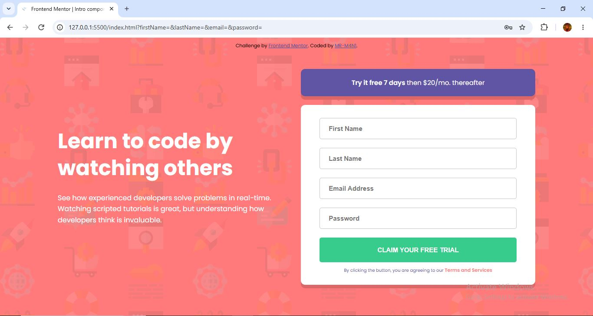
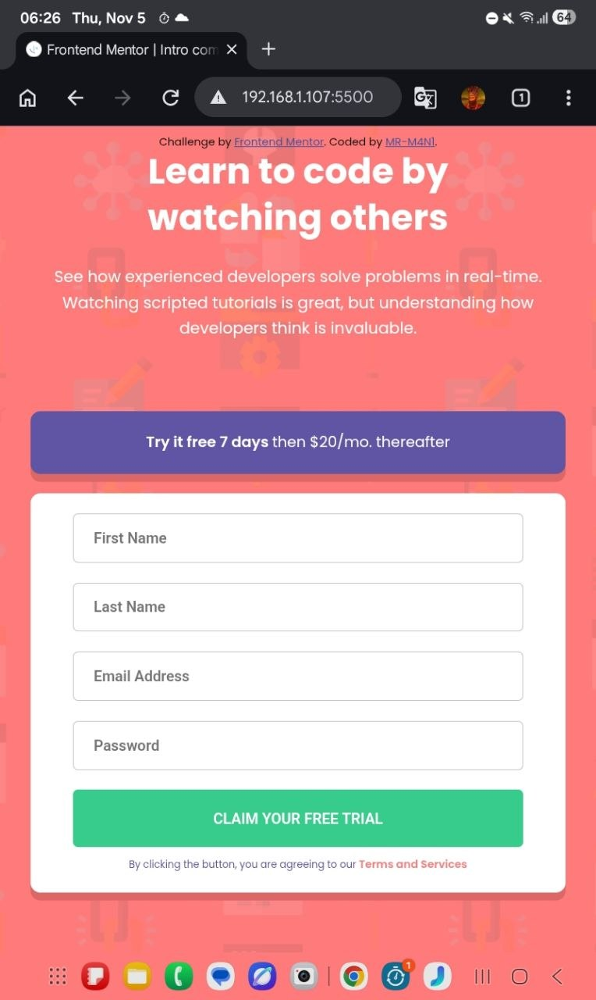
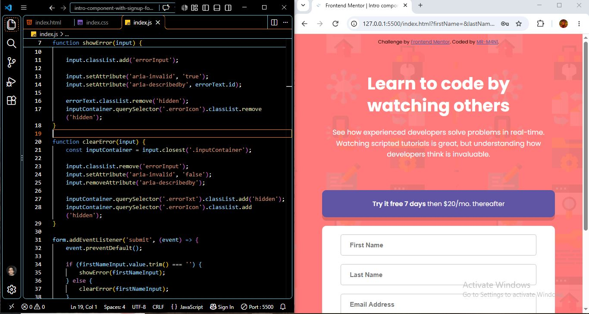

# Intro-component-with-sign-up-form
This is a my solution to the Intro component with sign up form challenge on Frontend Mentor
# Frontend Mentor - Intro component with sign up form solution

This is a solution to the [Intro component with sign up form challenge on Frontend Mentor](https://www.frontendmentor.io/challenges/intro-component-with-signup-form-5cf91bd49edda32581d28fd1). Frontend Mentor challenges help you improve your coding skills by building realistic projects. 

## Table of contents

- [Overview](#overview)
  - [The challenge](#the-challenge)
  - [Screenshot](#screenshot)
  - [Links](#links)
- [My process](#my-process)
  - [Built with](#built-with)
  - [What I learned](#what-i-learned)
  - [Continued development](#continued-development)
- [Author](#author)
- [Acknowledgments](#acknowledgments)

## Overview

### The challenge

Users should be able to:

- View the optimal layout for the site depending on their device's screen size
- See hover states for all interactive elements on the page
- Receive an error message when the `form` is submitted if:
  - Any `input` field is empty. The message for this error should say *"[Field Name] cannot be empty"*
  - The email address is not formatted correctly (i.e. a correct email address should have this structure: `name@host.tld`). The message for this error should say *"Looks like this is not an email"*

### Screenshot





### Links

- Solution URL: [Frontend Mentor Solution](https://your-solution-url.com)
- Live Site URL: [Live Demo](https://your-live-site-url.com)

## My process



### Built with

- Semantic HTML5
- CSS3
- Flexbox
- Responsive Web Design
- Mobile-First Workflow
- CSS Media Queries
- CSS Custom Properties
- CSS Functions (clamp(), min())
- CSS Positioning
- Custom Fonts (@font-face)
- JavaScript (ES6+)
- DOM Manipulation
- Client-Side Form Validation
- HTML Accessibility Attributes (ARIA)

### What I learned

- Array methods: Using find() to locate the first invalid input in a form.

```js
const firstInvalidInput = [
        firstNameInput,
        lastNameInput,
        emailInput,
        passwordInput
    ].find(input => input.classList.contains('errorInput'));
```

- Focus management: Using focus() to automatically move the user's focus to the first invalid input.

```js
  if (firstInvalidInput) {
        firstInvalidInput.focus();
    }
```

DOM attributes: Using setAttribute() to dynamically update accessibility attributes such as aria-invalid.

```js
  input.setAttribute('aria-invalid', 'false');
    input.removeAttribute('aria-describedby');
```

### Continued development

In future projects, I want to improve my JavaScript skills by writing cleaner and more maintainable code, deepen my understanding of web accessibility and form validation, and become more confident in building responsive layouts. I also want to improve my problem-solving skills and learn better ways to organize and structure my code.


## Author

- Frontend Mentor - [@MR-M4N1](https://www.frontendmentor.io/profile/MR-M4N1)
- Pinterest - [@MR-M4N1](https://www.pinterest.com/mrm4n1/?invite_code=4dc73b0e43814c3395c2f9600625eb5d&sender=1093671228168293050)
- LinkedIn - [@mani-ghorbanian](https://www.linkedin.com/in/mani-ghorbanian-351820327/)

## Acknowledgments

Thanks to Frontend Mentor for providing this challenge and the design resources that helped guide my implementation.
